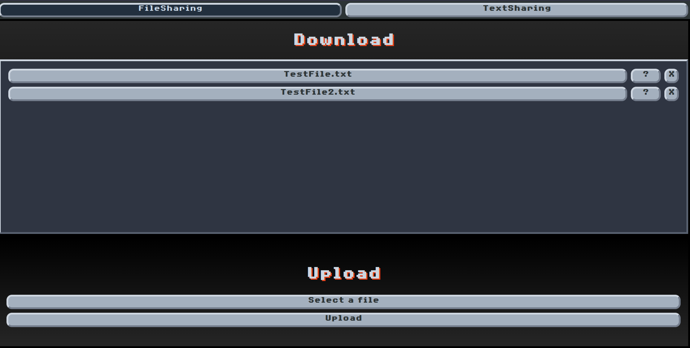
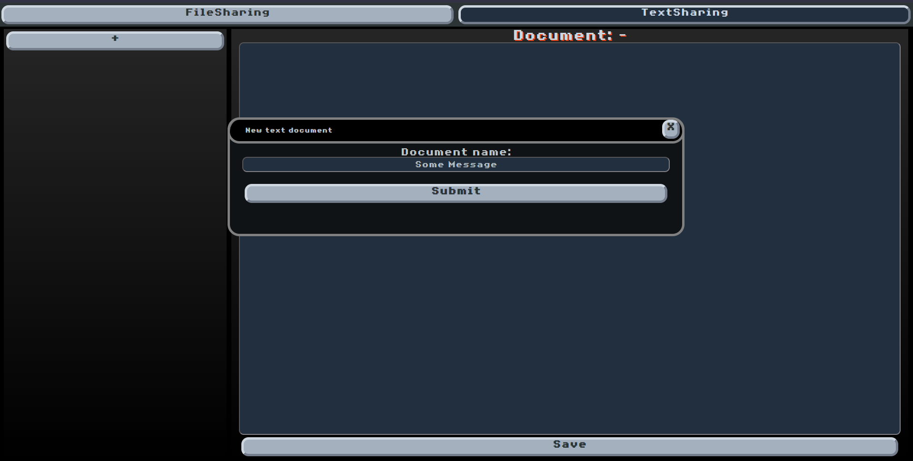
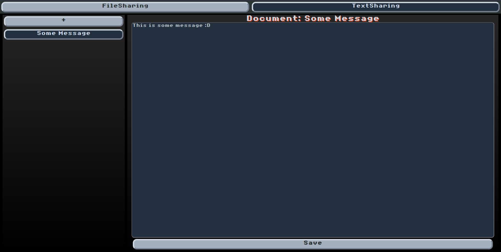

# FileSharingWebApp

A small personal file and text sharing app built with Node.js, Express, MongoDB, and plain HTML, CSS, and JavaScript, with a retro-inspired interface.

I built this as a fun side project to learn about Node.js, authentication, database management, and file uploads and downloads. It also became a practical way to share large files with people I know, without relying on third-party sharing sites outside my control. Building it helped me deepen my understanding of JavaScript, web development, and cybersecurity.

## File sharing

The file sharing page lets users upload files to the server, browse available files, and download them. Each file has controls to view its information, including its size and timestamps, or delete it when it is no longer needed.

## Shared text clipboard

The text sharing page acts as a shared clipboard for passing large amounts of text to other people. Users can create named documents, select them from the sidebar, and read, edit, and save their contents. Documents are stored in MongoDB so they can be opened again later.

## Authentication and configuration

The app includes an optional username and password login using Passport, bcrypt password hashes, and sessions. Its configuration controls authentication, the upload folder, database connection, and whether uploads and downloads are enabled.

## Personal use and project status

This project is intended for personal use only and reflects a learning experience. It is provided as is, with no guarantee of safety, security, or reliability. Bugs may occur and should be expected. Use it at your own risk.
